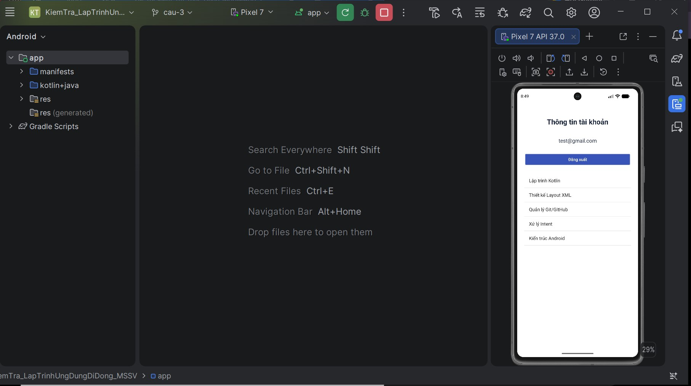
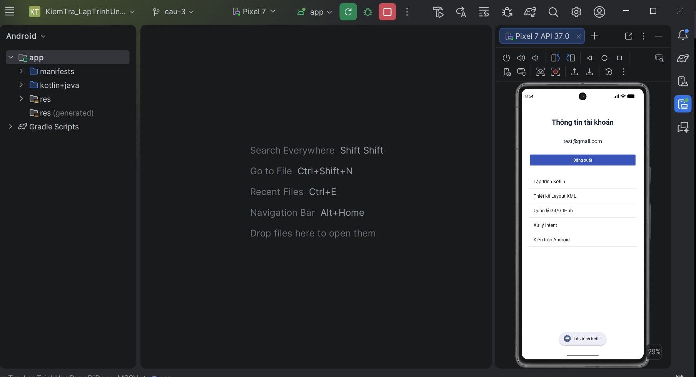

# BÀI THI THỰC HÀNH - CẢ 3 CÂU

- Họ và tên: Nguyễn Ngọc Nhân
- MSSV: 2273402010349
- Nhánh: `cau-3`

## Nội dung
- LoginActivity bằng ConstraintLayout phẳng, đúng 5 thành phần chính.
- Ánh xạ `findViewById`, **không dùng ViewBinding**.
- Kiểm tra dữ liệu trống, `Patterns.EMAIL_ADDRESS`, mật khẩu ít nhất 6 ký tự.
- Thông báo lỗi hoặc `Xác thực thành công!` trên `txtStatus`.

## Minh chứng Câu 1
> **Cần chụp ảnh THẬT trên thiết bị hoặc Emulator và lưu đúng tên; file ZIP không có ảnh giả.**

**Cách thử:**
- Email `abc`, mật khẩu `123456` → lỗi định dạng Email.
- Email `test@gmail.com`, mật khẩu `123456` → `Xác thực thành công!`.

## Minh chứng Câu 2
> Chạy đăng nhập hợp lệ để chuyển sang ProfileActivity rồi chụp Email hiển thị đúng.

- `LoginActivity`: `Intent(this, ProfileActivity::class.java)` và `putExtra()`.
- `ProfileActivity`: `getStringExtra()` và `finish()` khi Đăng xuất.

## Minh chứng Câu 3

- `ProfileActivity` có `ListView` dưới phần Email và nút Đăng xuất.
- `findViewById<ListView>`, `ArrayAdapter(android.R.layout.simple_list_item_1)`.
- `setOnItemClickListener` hiển thị Toast **đúng tên môn học**.

