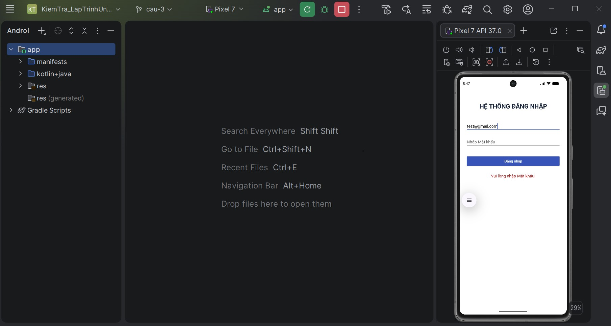
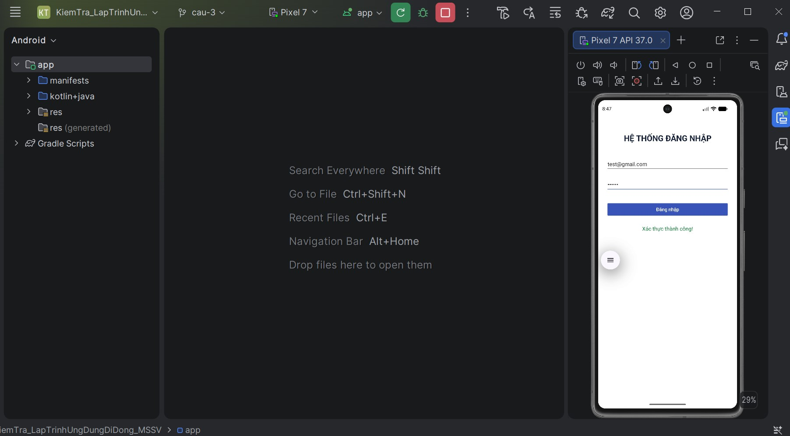

# BÀI THI THỰC HÀNH - CÂU 1 VÀ CÂU 2

- Họ và tên: Nguyễn Ngọc Nhân
- MSSV: 2273402010349
- Nhánh: `cau-2`

## Nội dung
- LoginActivity bằng ConstraintLayout phẳng, đúng 5 thành phần chính.
- Ánh xạ `findViewById`, **không dùng ViewBinding**.
- Kiểm tra dữ liệu trống, `Patterns.EMAIL_ADDRESS`, mật khẩu ít nhất 6 ký tự.
- Thông báo lỗi hoặc `Xác thực thành công!` trên `txtStatus`.

## Minh chứng Câu 1

### Kiểm tra dữ liệu không hợp lệ

### Kiểm tra dữ liệu hợp lệ

## Minh chứng Câu 2

- `LoginActivity`: `Intent(this, ProfileActivity::class.java)` và `putExtra()`.
- `ProfileActivity`: `getStringExtra()` và `finish()` khi Đăng xuất.
